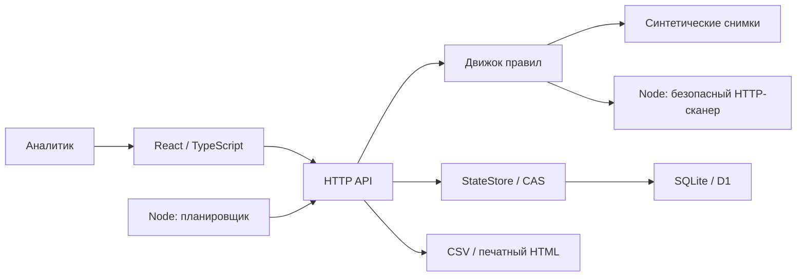

# Архитектура

Выбран модульный монолит: для одного пилотного рабочего пространства он проще в эксплуатации, чем микросервисы, и позволяет проверять весь бизнес-сценарий без сети. Один и тот же движок работает в Node.js и Worker; различаются только адаптеры среды.

## Границы модулей

- `core/model.mjs`: входные инварианты, пороги, агрегация, безопасный экспорт.
- `core/analyze.mjs`: чистое преобразование наблюдений в проверки и балл.
- `core/api.mjs`: прикладные операции, авторизация контекстом, импорт, резервирование, аудит.
- `core/seed.mjs`: исключительно вымышленные данные и детерминированные снимки.
- `core/reports.mjs`: экранированный отчёт без скриптов.
- `server/scanner.mjs`: DNS, защита SSRF, закрепление IP, ограниченный обход и извлечение HTML.
- `server/store.mjs`: порт хранения, CAS, память для тестов и D1.
- `server/node.mjs`: Node HTTP, SQLite, ключ/сессия, ограничения запросов, планировщик.
- `server/worker.mjs`: адаптер Sites, серверная identity, D1 и выдача статических ресурсов.
- `client/`: интерфейс; исходные HTML-страницы не внедряются через `dangerouslySetInnerHTML`.

## Модель

`Merchant`: id, имя, URL, ИНН/УНП/БИН, MCC, monitoring, interval, nextScanAt, createdAt; для seed дополнительно demoProfile.

`Scan`: id, merchantId, merchantSnapshot, createdAt, mode, checks[], score, risk, completeness, violations, pages[], extracted, engineVersion, dictionaryVersion.

`Check`: id, группа, заголовок, status, вес, результат, evidence[].

`Evidence`: URL, текстовый фрагмент (до 420 символов), capturedAt. Бинарные скриншоты сайта не сохраняются.

`DictionaryEntry`: id, term, category, weight, enabled. Версия правил включена в результат, изменение записи не пересчитывает старые результаты.

`Review`: verdict, note, actor, at; ключ scanId:checkId. Решение не меняет исторический балл.

`AuditEvent`: действие, сущность, автор, время. Журнал прикладной, не WORM и не криптографический аудит.

## Транзакции и конкурентность

Состояние хранится как JSON с version в таблице `workspace_state`. Операция читает версию, создаёт копию, выполняет синхронную бизнес-транзакцию и делает условный UPDATE по версии. Проигравший конфликт повторяет операцию, поэтому импорт, карточка, решение и аудит сохраняются атомарно.

Сетевой обход выполняется вне транзакции. До него резервируется мерчант на 2 минуты, после него сохраняются результат, следующая дата и аудит. Ошибка освобождает резерв. При аварии резерв истекает. Это не очередь с гарантией exactly-once; допустим повтор сканирования после аварии до фиксации результата.

SQLite использует WAL. D1 предоставляет те же инварианты через conditional UPDATE. Начальная схема создаётся миграцией, seed — отдельными данными при первом обращении. Рабочие данные не входят в deploy-архив, новый релиз их не сбрасывает.

## Выбор и границы хранения

JSON-агрегат упрощает атомарность и переносимость тестового стенда, но целиком читается и записывается. Это ограничение пилота, не архитектура для неограниченного банковского портфеля. Дополнительная проверка размера ограничивает агрегат перед записью, сохраняя предыдущее состояние при переполнении.

Следующий этап: отдельные таблицы merchants/scans/checks/evidence/dictionaries/reviews/audit; PostgreSQL с транзакциями и индексами `(merchant_id,created_at)`; S3/R2 для снапшотов; очередь и отдельные worker-процессы; адаптеры источников с freshness и sourceVersion. Публичный API и чистый движок можно сохранить.

## Развёртывание

Node.js — основная версия с живым сканером и расписанием. Docker сохраняет SQLite в volume. Sites — приватный тестовый экземпляр с общим API, D1 и демо-сканером. В Workers отсутствует Node DNS/socket API с выбранной моделью закрепления IP, поэтому живая проверка там явно недоступна, а не реализована менее защищённым обходом.
