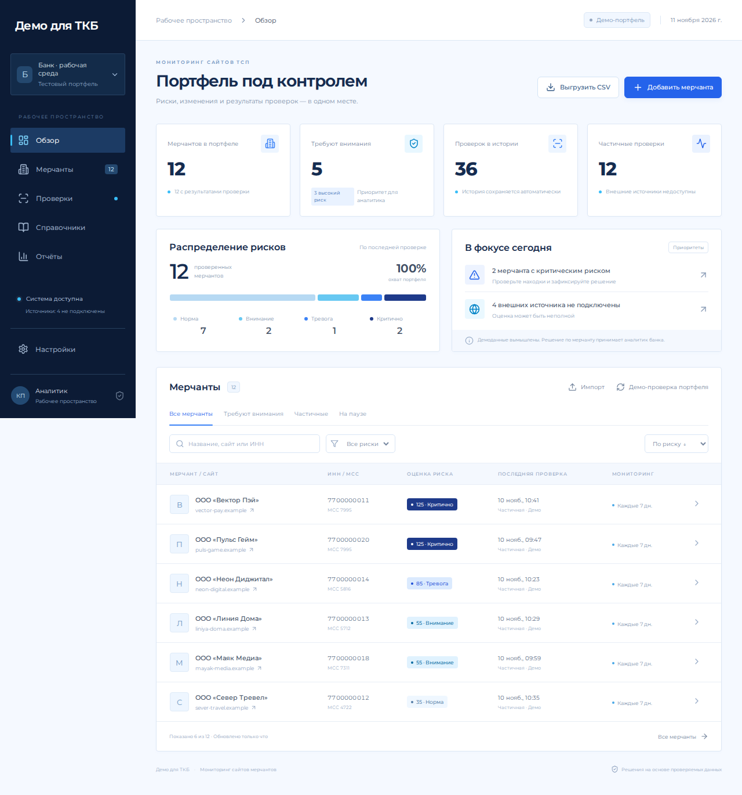

# Регрессионное тестирование

Итог обновления синей и голубой палитры «Демо для ТКБ»: **PASS**. Проверен код `b81ab40553295a485f3de74d9aa69086d563e841`, 11 ноября 2026 года.

[Успешный GitHub Actions](https://github.com/kirillpivovarov/merchants/actions/runs/43006408458) · [HTML-отчёт и артефакты](https://github.com/kirillpivovarov/merchants/actions/runs/43006408458/artifacts/13847928853).

| Проверка | Результат |
|---|---|
| TypeScript и production build | PASS |
| Unit / API / storage / Node runtime / scanner | **77 из 77**, 5 файлов |
| Chromium, desktop и mobile | **12 из 12**, без повторов, 10,6 с |
| Палитра на шести экранах | PASS: синие, голубые и нейтральные цвета; основные кнопки `#2563eb`, навигация `#0c1b35` |
| Шрифт и текстовое название | PASS: Montserrat, «Демо для ТКБ», без SVG в бренде |
| Печатный отчёт | PASS: синие ссылки, голубые акценты, локальный шрифт |
| Собранный Worker | PASS: ресурсы, identity, D1-совместимый SQLite, сохранение, scan, report |
| Развёртывание Sites | succeeded |
| Размещённые `/` и `/api/health` | 200, хранилище ready |
| `/api/state` без пользовательской identity | 401, защита записей сохранена |
| Дифф бизнес-модулей, сканера, API, хранилища и hosting identity | Изменений нет |

Покрытие выбранного ядра: **98,25% строк**, 97,47% statements, 97,14% functions, 93,05% branches. Этот показатель не относится ко всему JSX.

Публикация: https://tkb-demo.kirillpivovarov.chatgpt.site . Версия: `appgprj_6af4363fc42c8191a6025c05bd021e11~appgver_0a47f92c4a9c8191bac346893af0bc91`; deployment `appgdep_6af447e163508191a8ecd461cb613bed`.

## Оформление и снимки из успешного прогона

Палитра и типографика описаны в [DESIGN.md](DESIGN.md). Снимки: [обзор](screenshots/overview-desktop.png), [мобильный экран](screenshots/overview-mobile.png), [карточка](screenshots/merchant-evidence.png), [печатный отчёт](screenshots/audit-report.png).

## Уровни

- Unit: границы риска 50/51/80/81/99/100, недоступность источников, извлечение, веса, экранирование, согласованность сводки.
- API: создание/изменение, дубликаты, атомарный импорт, запуск проверок, история, решения, справочники, расписание, JSON/Origin/размеры запросов.
- Persistence: CAS с параллельными обновлениями, конфликт, протокол D1 поверх настоящего SQLite, ограничение размера.
- Node runtime: реальный процесс HTTP, вход/cookie, SQLite и восстановление записей после перезапуска.
- Scanner: mock HTTP/DNS на уровне транспорта, private/mixed DNS/IPv6, закрепление IP, редиректы, размер, ошибки сервера, извлечение и ограниченный обход.
- E2E: реальный Chromium и Node API; обзор, навигация, фильтры, карточка/доказательства/решение, создание/сканирование/пауза, импорт, справочники, экспорт, настройки и мобильный экран.

## Что считается проверенным

Покрытие относится к бизнес-ядру, адаптеру хранения и сканеру, а не ко всему JSX и не ко внешним платным реестрам. E2E не заменяет проверку юридической методики, нагрузочное испытание или пенетест.

## Исправления в ходе регресса

Первый прогон Chromium: 7 из 10 сценариев прошли. Три падения выявили две неоднозначности доступных имён: число в пункте «Мерчанты» и текст вложенных option в поле «Решение». Добавлены явные aria-label в реальный интерфейс; сценарии не ослаблены. После исправлений тот же набор сценариев выполнен повторно: 10 из 10 PASS.

- Исторический отчёт использует снимок карточки мерчанта: изменение текущего имени не переписывает прошлое.
- Ошибки действий видны поверх карточки и модального окна.
- Импорт проверяет заголовок, BOM, дубликаты и все строки до записи.
- Чужой Origin отклоняется; CSV защищён от формул; HTML экранирован и не содержит скриптов.
- Проверяются все DNS-ответы и адрес каждого редиректа; IP закреплён для сокета; IPv4/IPv6 классифицирует ipaddr.js.
- Срок сессии проверяется сервером; не только Max-Age в браузере.
- Превышение размера агрегата отклоняется до записи; проигранные CAS-обновления повторяются.
- После удаления старой проверки удаляются и её решения, чтобы они не накапливались бесконечно.
- Обновлены зависимости сборки и тестов, удалён неиспользуемый генератор схем; полный npm audit не сообщает известных уязвимостей.
- Локальные шрифты включены в сборку: интерфейс не зависит от Google Fonts.

## Ограничения среды

В управляемой среде отсутствует инструмент `cua_repl.js`, а `sites-preview status` сообщает `preview relay unavailable`. Локальный браузерный обход Sites не заявляется как выполненный. Вместо него E2E запускается в GitHub Actions; артефакты сохраняются 14 дней. Отдельно после публикации проверяется API размещённого экземпляра с разрешённым service access. Полная ручная/визуальная приёмка пользователем остаётся отдельной процедурой.
